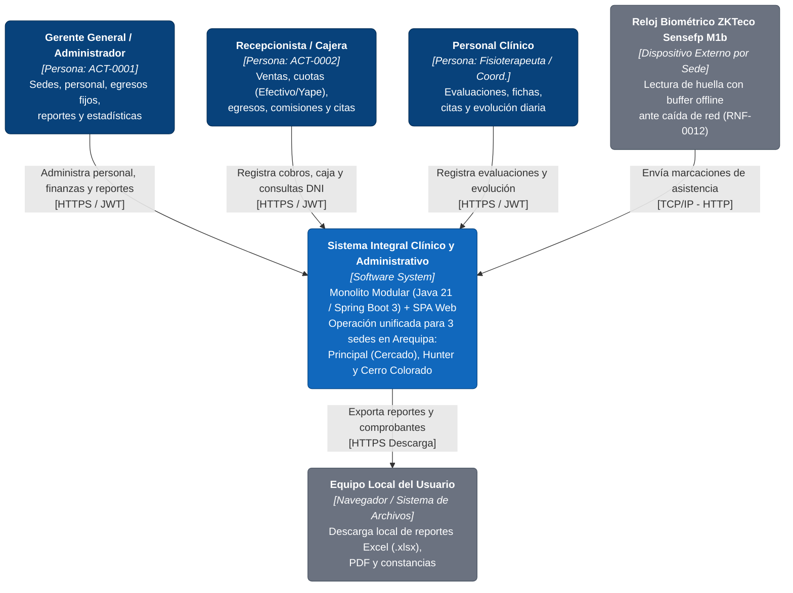

# Diagrama C4 — Nivel 1: Contexto del Sistema

Vista de máximo nivel del **Sistema Integral Clínico y Administrativo**, mostrando quiénes operan la plataforma y con qué dispositivos externos interactúa, conforme a [ADR-0001](../adr/0001-adopcion-monolito-modular-clean-architecture.md) a [ADR-0005](../adr/0005-registro-financiero-manual-sin-pasarela-de-pagos.md).

## Alcance y Fronteras del Contexto

- **Unificación Clínica y Administrativa ([ADR-0001](../adr/0001-adopcion-monolito-modular-clean-architecture.md)):** El módulo clínico (antes concebido como sistema externo InnovaByte) forma parte del mismo sistema unificado; no aparece como sistema externo en C1.
- **Sin Pasarela de Pagos Externa ([ADR-0005](../adr/0005-registro-financiero-manual-sin-pasarela-de-pagos.md)):** Todos los pagos (Efectivo, Yape/Plin y Transferencia) se verifican y registran de forma presencial en mostrador por la Recepcionista o el Gerente. No existen integraciones con Niubiz, Culqi ni Stripe.
- **Pacientes y Derivadores:** No disponen de portal web ni acceso directo al sistema; interactúan presencialmente con Recepción y Personal Clínico.
- **Operación Multi-Sede ([ADR-0003](../adr/0003-gestion-multisede-mediante-discriminador-sede-id.md)):** Una sola instancia lógica atiende simultáneamente las sedes **Principal (Cercado)**, **Hunter** y **Cerro Colorado**.
