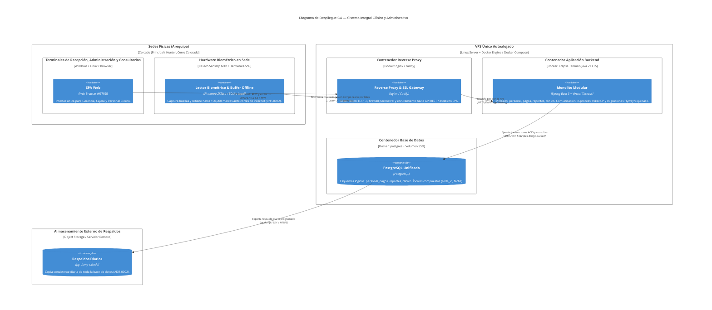

# Diagrama de Despliegue C4 — Todo el Sistema

Representa la topología física y de contenedores en producción sobre un **VPS único autoalojado**, operando las 3 sedes físicas en Arequipa (Cercado/Principal, Hunter y Cerro Colorado), de acuerdo con [ADR-0001](../adr/0001-adopcion-monolito-modular-clean-architecture.md), [ADR-0002](../adr/0002-base-de-datos-unificada-postgresql-con-esquemas-logicos.md) y [`arq-diagram_v2.md`](arq-diagram_v2.md).

## Decisiones de Despliegue Clave

1. **VPS Único con Docker Compose ([ADR-0001](../adr/0001-adopcion-monolito-modular-clean-architecture.md)):** Se evita la sobrecarga de costo y operación de Kubernetes o PaaS distribuidos; todos los contenedores corren en un mismo host con reinicio automático (`restart: unless-stopped`).
2. **Cero Broker de Mensajería ([ADR-0004](../adr/0004-eliminacion-broker-mensajeria-y-comunicacion-hibrida-in-process.md)):** No existe contenedor RabbitMQ ni Azure Service Bus en el VPS; la comunicación entre módulos ocurre en memoria dentro del contenedor `clinical-monolith`.
3. **Instancia Única de PostgreSQL ([ADR-0002](../adr/0002-base-de-datos-unificada-postgresql-con-esquemas-logicos.md)):** Un solo volumen SSD y un único proceso `pg_dump` simplifican backups y garantizan consistencia referencial entre `pagos`, `personal`, `clinico` y `reportes`.
4. **Resiliencia en Sedes Periféricas (`RNF-0012`):** Si cae el enlace de internet en Hunter o Cerro Colorado, el reloj ZKTeco / buffer local retiene marcaciones y las sincroniza cronológicamente al restablecerse la conexión.
