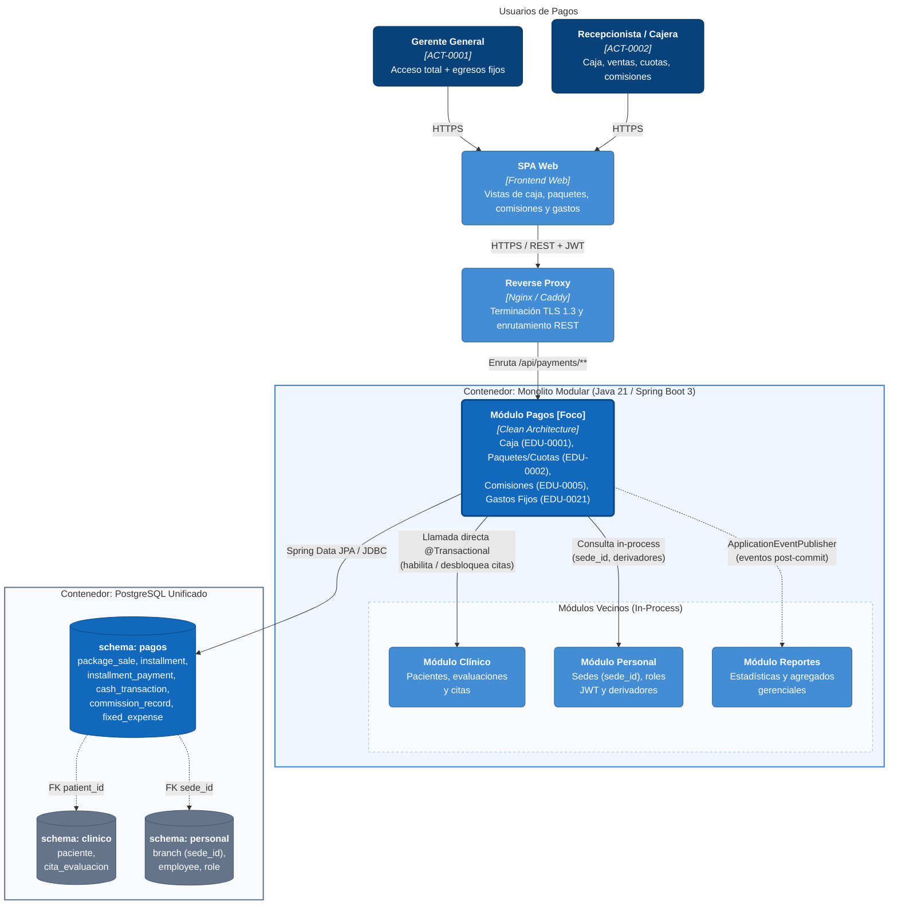

# Diagrama C4 — Nivel 2 (Payments): Contenedores y Fronteras Modulares

En un **Monolito Modular** ([ADR-0001](../../../adr/0001-adopcion-monolito-modular-clean-architecture.md)), el módulo `pagos` convive dentro del mismo contenedor desplegable (`Spring Boot 3`) que `personal`, `reportes` y `clinico`, comunicándose *in-process* ([ADR-0004](../../../adr/0004-eliminacion-broker-mensajeria-y-comunicacion-hibrida-in-process.md)) y persistiendo exclusivamente en su esquema lógico de PostgreSQL ([ADR-0002](../../../adr/0002-base-de-datos-unificada-postgresql-con-esquemas-logicos.md)).

## Reglas de Frontera para `pagos`

- **Escritura Exclusiva ([ADR-0002](../../../adr/0002-base-de-datos-unificada-postgresql-con-esquemas-logicos.md)):** `pagos` solo ejecuta `INSERT` / `UPDATE` sobre el esquema `pagos`; cualquier cambio de estado clínico (habilitar paquete o desbloquear citas) se invoca a través de los puertos públicos de aplicación del módulo `clinico`.
- **Aislamiento Multi-Sede ([ADR-0003](../../../adr/0003-gestion-multisede-mediante-discriminador-sede-id.md)):** Cada movimiento en `cash_transaction`, `package_sale` y `fixed_expense` lleva `sede_id`, filtrado automáticamente según el contexto JWT de la Cajera o abierto a todas las sedes para el Gerente General.
- **Sin Pasarela Externa ([ADR-0005](../../../adr/0005-registro-financiero-manual-sin-pasarela-de-pagos.md)):** No existen adaptadores salientes hacia bancos o procesadores de tarjetas; la caja distingue internamente `CASH` (Efectivo), `YAPE` y `BANK_TRANSFER`.
