# Diagrama C4 — Nivel 3 (Payments): Componentes Internos (Clean Architecture)

Descompone el interior del **Módulo Pagos** siguiendo Clean Architecture / Hexagonal ([ADR-0001](../../../adr/0001-adopcion-monolito-modular-clean-architecture.md)), en total correspondencia con el modelo de dominio [`step-01-domain-model.puml`](../../../UML/payments/complete/step-01-domain-model.puml) y el esquema v2 [`payment-service-bd-v02.md`](../../../databases/payment-service-bd-v02.md).

```mermaid
C4Component
    title C3 — Componentes Internos del Módulo Pagos (services/payments)

    Container(proxy, "Reverse Proxy / SPA", "Nginx + Web", "Envía peticiones REST autenticadas con JWT.")
    Container(mod_clinico, "Módulo Clínico", "Puertos de Aplicación", "Validación de paciente y habilitación/desbloqueo de citas.")
    Container(mod_personal, "Módulo Personal", "Puertos de Aplicación", "Catálogo de sedes (sede_id) y derivadores.")
    Container(mod_reportes, "Módulo Reportes", "Listeners @Async", "Actualiza métricas gerenciales ante eventos.")
    ContainerDb(db_pagos, "PostgreSQL (schema: pagos)", "Base de Datos", "8 tablas: patient, package_sale, installment, installment_payment, cash_transaction, referrer, commission_record, fixed_expense.")
    Container(archivo_xlsx, "Descarga .xlsx", "Respuesta HTTP Binaria", "Reporte mensual de comisiones en Excel.")

    Container_Boundary(pagos, "Módulo Pagos — Clean Architecture") {
        Component(security_filter, "JwtBranchContextFilter", "Spring Security Filter", "Valida JWT, rol (ACT-0001 / ACT-0002) y fija contexto sede_id.")
        Component(ctrl_cash, "CashTransactionController", "REST Controller", "Endpoints EDU-0001: egresos operativos diarios y arqueo Efectivo/Yape.")
        Component(ctrl_sale, "PackageSaleController", "REST Controller", "Endpoints EDU-0002: venta de paquetes, cuotas y deuda por DNI.")
        Component(ctrl_comm, "CommissionController", "REST Controller", "Endpoints EDU-0005: comisiones a promotores/traumatólogos y Excel.")
        Component(ctrl_exp, "FixedExpenseController", "REST Controller", "Endpoints EDU-0021: egresos fijos (exclusivo Gerente General).")

        Component(uc_cash, "CashManagementUseCase", "Application Service", "Registra entradas/salidas en caja, edita y aplica borrado lógico.")
        Component(uc_sale, "PackageSale & InstallmentUseCase", "Application Service", "Calcula IGV 18%, descuento S/ 25, valida abono >= S/ 50, consentimiento y deuda dinámica.")
        Component(uc_comm, "CommissionManagementUseCase", "Application Service", "Calcula comisiones, liquida pagos a caja y arma reporte mensual.")
        Component(uc_exp, "FixedExpenseUseCase", "Application Service", "Gestiona gastos fijos y registra salida en caja al confirmar pago.")

        Component(domain, "Núcleo de Dominio & Puertos", "Java Puro (Aggregates & Ports)", "PackageSale, Installment, InstallmentPayment, CashTransaction, Referrer, CommissionRecord, FixedExpense, Money; *Repository y ClinicalNotificationPort.")

        Component(jpa_adapter, "JpaPaymentsAdapter", "Spring Data JPA / Hibernate", "Repositorios y mapeo relacional hacia schema: pagos.")
        Component(clinical_adapter, "InProcessClinicalAdapter", "Port Adapter", "Implementa ClinicalNotificationPort vía llamada directa @Transactional.")
        Component(personal_adapter, "InProcessPersonalAdapter", "Port Adapter", "Consulta sedes y datos de derivadores en personal.")
        Component(event_adapter, "SpringEventPublisherAdapter", "ApplicationEventPublisher", "Publica PackageSaleCompletedEvent, InstallmentDefaultedEvent, CashOutflowRegisteredEvent, FixedExpensePaidEvent.")
        Component(excel_adapter, "ExcelCommissionExporter", "Apache POI / Export Adapter", "Genera archivo .xlsx estructurado para cuadre contable.")
    }

    Rel(proxy, security_filter, "Peticiones /api/payments/**", "HTTP + JWT")
    Rel(security_filter, ctrl_cash, "Autoriza Cajera / Gerente")
    Rel(security_filter, ctrl_sale, "Autoriza Cajera / Gerente")
    Rel(security_filter, ctrl_comm, "Autoriza Cajera / Gerente")
    Rel(security_filter, ctrl_exp, "Autoriza solo ACT-0001")

    Rel(ctrl_cash, uc_cash, "Delega comandos/consultas")
    Rel(ctrl_sale, uc_sale, "Delega ventas/cuotas/deuda")
    Rel(ctrl_comm, uc_comm, "Delega comisiones/reporte")
    Rel(ctrl_exp, uc_exp, "Delega gastos fijos")

    Rel(uc_cash, domain, "Ejecuta reglas y persiste vía Output Ports")
    Rel(uc_sale, domain, "Ejecuta reglas, notifica clínico y emite eventos")
    Rel(uc_comm, domain, "Ejecuta reglas y genera reporte")
    Rel(uc_exp, domain, "Ejecuta reglas y persiste vía Output Ports")

    Rel(domain, jpa_adapter, "Usa interfaces *Repository")
    Rel(domain, clinical_adapter, "Usa ClinicalNotificationPort")
    Rel(domain, personal_adapter, "Consulta sede/derivadores")
    Rel(domain, event_adapter, "Publica DomainEvents")
    Rel(uc_comm, excel_adapter, "Exporta historial filtrado")

    Rel(jpa_adapter, db_pagos, "SQL / ACID", "JDBC")
    Rel(clinical_adapter, mod_clinico, "Habilita paquete / desbloquea citas", "In-Process")
    Rel(personal_adapter, mod_personal, "Lee branch y derivadores", "In-Process")
    Rel(event_adapter, mod_reportes, "Notifica post-commit", "Event Bus en memoria")
    Rel(excel_adapter, archivo_xlsx, "Genera stream binario", "XLSX")

    UpdateLayoutConfig($c4ShapeInRow="4", $c4BoundaryInRow="1")
```

## Trazabilidad de Reglas de Negocio en los Componentes

| Componente | Responsabilidad Crítica | Referencia |
| :--- | :--- | :--- |
| `JwtBranchContextFilter` | Restringe `FixedExpenseController` a `ACT-0001` y aplica filtro `sede_id` a `ACT-0002` | [ADR-0003](../../../adr/0003-gestion-multisede-mediante-discriminador-sede-id.md) |
| `PackageSale & InstallmentUseCase` | Recalcula IGV (18%) y descuento (S/ 25) en backend; exige abono inicial $\ge$ S/ 50 y consentimiento informado | [`payments-service.md`](../payments-service.md) |
| `domain` (`Installment` vs `InstallmentPayment`) | Separa la deuda (`installment`) del movimiento real (`installment_payment` -> `cash_transaction`) permitiendo pagos parciales | [`payment-service-bd-v02.md`](../../../databases/payment-service-bd-v02.md) |
| `InProcessClinicalAdapter` | Habilita sesiones y desbloquea citas dentro de la misma transacción o inmediatamente post-pago, sin colas RabbitMQ | [ADR-0004](../../../adr/0004-eliminacion-broker-mensajeria-y-comunicacion-hibrida-in-process.md) |
| `JpaPaymentsAdapter` | Garantiza borrado lógico (`ANNULLED`) en anulaciones, conservando historial de auditoría | [`payments-service.md`](../payments-service.md) |
