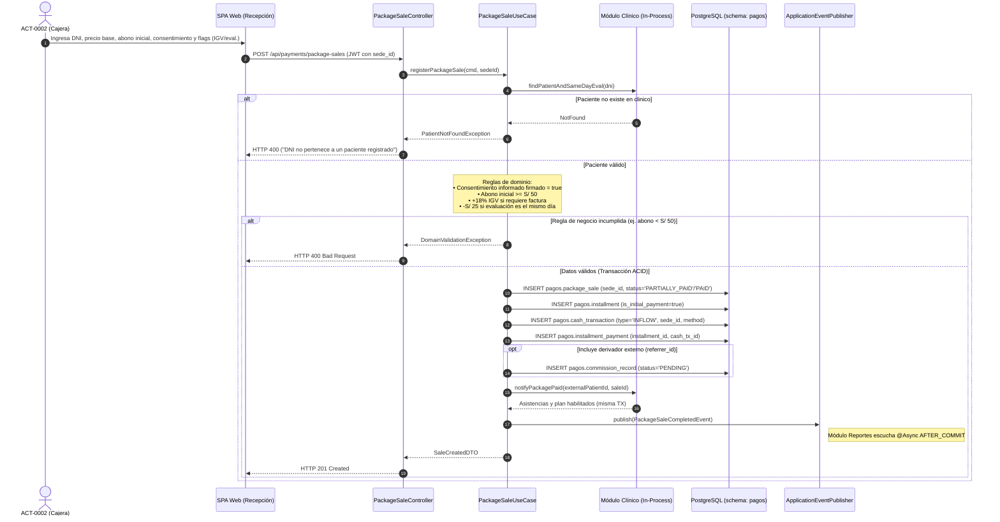
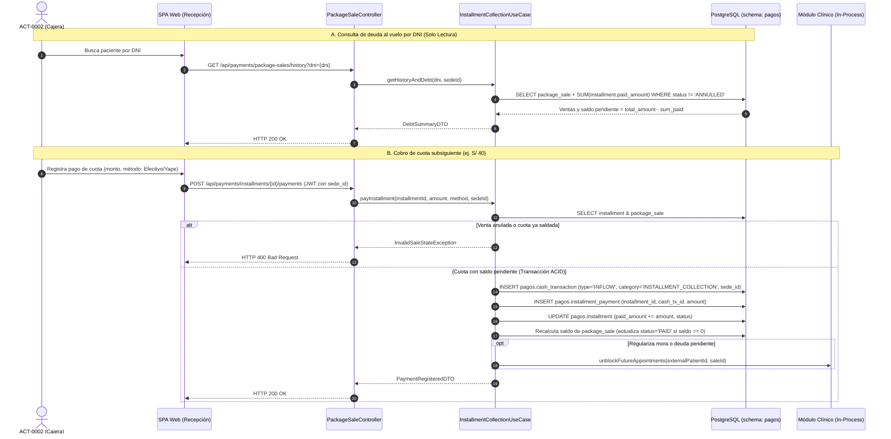
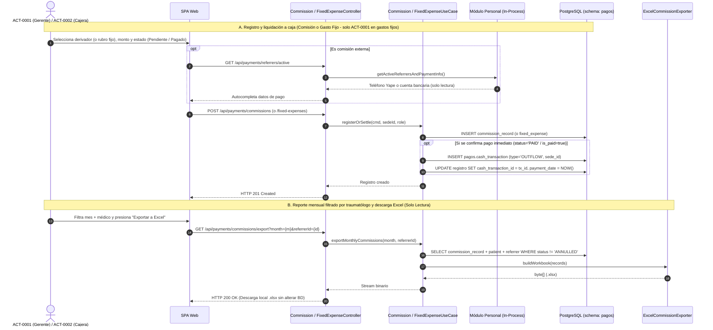
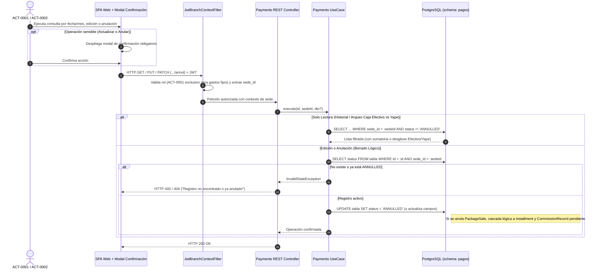

# Diagramas de Secuencia Esenciales — Módulo de Pagos (`services/payments`)

Este documento consolida la vista dinámica del módulo de pagos en **4 diagramas esenciales** alineados con la arquitectura vigente: **Monolito Modular con Clean Architecture** ([ADR-0001](../../../adr/0001-adopcion-monolito-modular-clean-architecture.md)), **PostgreSQL unificado en esquema `pagos`** ([ADR-0002](../../../adr/0002-base-de-datos-unificada-postgresql-con-esquemas-logicos.md)), **discriminador `sede_id`** ([ADR-0003](../../../adr/0003-gestion-multisede-mediante-discriminador-sede-id.md)), **comunicación híbrida in-process** ([ADR-0004](../../../adr/0004-eliminacion-broker-mensajeria-y-comunicacion-hibrida-in-process.md)) y el **modelo relacional v2 (`installment` + `installment_payment`)** ([`payment-service-bd-v02.md`](../../../databases/payment-service-bd-v02.md)).

---

## Criterio de Reducción y Justificación

Anteriormente existían **18 diagramas** distribuidos en 5 archivos (`seq-01` a `seq-04` + maestro), donde 12 de ellos repetían el mismo flujo CRUD lineal (`UI -> Controller -> Service -> DB`) con cambios menores de campos o ventanas modales, y arrastraban supuestos obsoletos (`payments_db` aislada, llamadas HTTP a un InnovaByte externo y ausencia de `installment_payment`).

Se redujeron a **4 diagramas** bajo la regla de documentar dinámicamente solo flujos con **lógica de negocio compleja, transacciones multi-tabla o coordinación inter-modular**:

| Secuencia Conservada | Requisitos Cubiertos | Justificación Arquitectónica |
| :--- | :--- | :--- |
| **1. Venta de Paquete con Abono Inicial y Habilitación Clínica** | `EDU-0002` (`ILA-PAG-0005`), `EDU-0001`, `EDU-0005` | Único flujo con cálculos fiscales en backend (IGV 18%, descuento S/ 25, abono $\ge$ S/ 50), transacción ACID sobre 5 tablas y comunicación híbrida *in-process* (llamada síncrona a `clinico` + evento en memoria a `reportes`). |
| **2. Deuda Dinámica por DNI y Cobro de Cuota (`v02`)** | `EDU-0002` (`ILA-PAG-0006`, `ILA-PAG-0007`) | Ilustra la separación crítica del modelo `v02` entre obligación (`installment`) y pago real (`installment_payment` $\rightarrow$ `cash_transaction`), el cálculo de deuda al vuelo y el desbloqueo condicional de citas. |
| **3. Liquidación de Obligaciones (Comisiones / Gastos Fijos) y Excel** | `EDU-0005` (`ILA-PAG-0009..0011`), `EDU-0021` (`ILA-PAG-0013`) | Muestra la consulta *in-process* al módulo `personal`, la regla donde una obligación pendiente solo genera salida en `cash_transaction` al pagarse, y la exportación `.xlsx` sin mutar la BD. |
| **4. Patrón Transversal: Consulta, Edición y Anulación Lógica** | `EDU-0001` (`ILA-PAG-0001..0004`), `ILA-PAG-0008`, `0011..0016` | Condensa en un solo patrón los 12 diagramas CRUD repetitivos (egresos operativos, egresos fijos y anulaciones): filtro por `sede_id`/rol vía JWT, confirmación modal y borrado lógico (`status = 'ANNULLED'`). |

---

## 1. Venta de Paquete con Abono Inicial y Habilitación Clínica

Orquesta validaciones financieras en dominio, inserción atómica en `pagos` y habilitación inmediata de atenciones en el módulo `clinico` dentro de la misma transacción/solicitud.

---

## 2. Consulta de Deuda Dinámica y Cobro de Cuota (`v02`)

La deuda nunca se almacena como columna estática: se calcula en tiempo real restando las cuotas abonadas. Cada cobro crea un `installment_payment` vinculado a `cash_transaction` y desbloquea citas si regulariza el saldo.

---

## 3. Liquidación de Comisiones Externas / Gastos Fijos y Exportación Excel

Distingue el registro de la obligación (`PENDING` / `is_paid=false`) de su desembolso real en caja (`cash_transaction` tipo `OUTFLOW`), e integra lectura con `personal` y descarga `.xlsx`.

---

## 4. Patrón Transversal: Consulta, Edición y Anulación Lógica

Aplica de manera uniforme a **Egresos Operativos (`EDU-0001`)**, **Gastos Fijos (`EDU-0021`)**, **Edición/Anulación de Comisiones (`EDU-0005`)** y **Anulación de Ventas (`EDU-0002`)**.

### Mapa de Operaciones Cubiertas por el Patrón Transversal

| Dominio | Operaciones Cubiertas | Tabla en `schema: pagos` | Regla Específica |
| :--- | :--- | :--- | :--- |
| **Egresos Operativos (`EDU-0001`)** | Crear, consultar por fecha, editar, anular | `cash_transaction` (`type='OUTFLOW'`) | Arqueo diario separa totales en `CASH` (Efectivo) y `YAPE` |
| **Venta de Paquetes (`EDU-0002`)** | Anular venta | `package_sale`, `installment`, `commission_record` | Anulación en cascada lógica (comisiones no pagadas pasan a `ANNULLED`) |
| **Comisiones Externas (`EDU-0005`)** | Editar estado/monto, anular | `commission_record` (+ `cash_transaction` si pasa a `PAID`) | Requiere modal de confirmación |
| **Egresos Fijos (`EDU-0021`)** | Consultar historial mensual con sumatoria, editar, anular | `fixed_expense` | Acceso exclusivo `ACT-0001` (Gerente General) |
